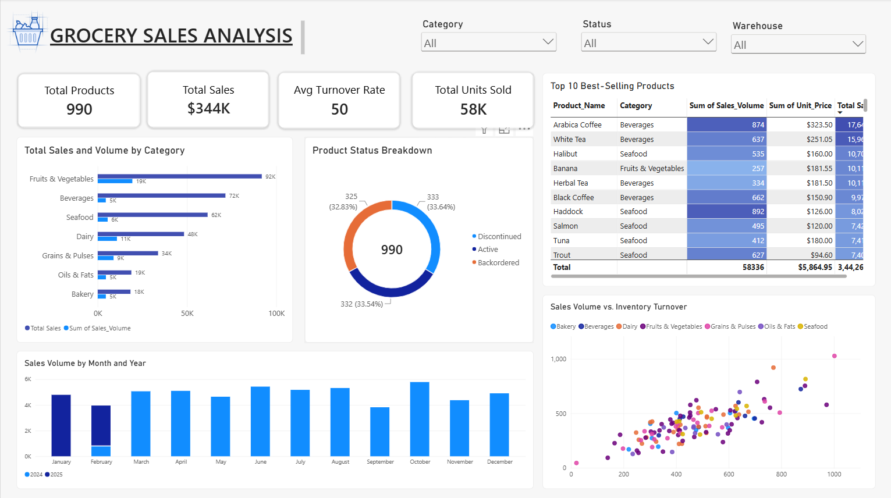
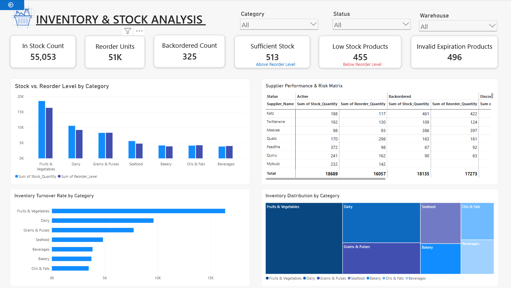

# Grocery Sales & Inventory Analysis Dashboard

**🌟 Project Overview**

The Grocery Sales & Inventory Analysis Dashboard is a Power BI-based data analytics project designed to analyze grocery product sales, inventory availability, stock levels, supplier performance, and product status.

The dashboard transforms raw grocery data into an interactive visual report, helping users monitor inventory levels, identify products requiring replenishment, analyze sales performance, understand inventory turnover, and evaluate stock distribution across different product categories.

The project consists of two interactive dashboard pages:

**1.Grocery Sales Analysis:** Focuses on overall sales performance, product sales volume, category-wise revenue, monthly sales trends, product status, and best-selling products.

**2.Inventory & Stock Analysis:** Provides insights into stock availability, reorder requirements, backordered products, supplier performance, inventory turnover, and inventory distribution.

Interactive slicers allow users to filter the dashboard by Category, Status, and Warehouse, making it easier to explore inventory and sales performance across different segments.

**📊 Business Problem**

Grocery businesses need to maintain the right balance between product availability and inventory levels while ensuring efficient sales performance.

Insufficient stock can lead to backorders and missed sales opportunities, whereas excessive inventory can increase storage costs and the risk of product expiration.

Similarly, analyzing raw sales and inventory data manually makes it difficult to identify best-selling products, monitor sales trends, evaluate supplier performance, and understand stock movement.

This project addresses these challenges by presenting sales and inventory metrics through an interactive Power BI dashboard, supporting better inventory planning and data-driven business decisions.

**🎯 Key Objectives**

1.Monitor overall grocery sales performance using key performance indicators (KPIs).

2.Analyze total sales and sales volume across different product categories.

3.Identify top 10 best-selling grocery products.

4.Analyze monthly sales volume trends across 2024 and 2025.

5.Monitor product availability and identify low-stock products.

6.Compare available stock quantities against reorder levels.

7.Identify backordered products and monitor product status distribution.

8.Analyze inventory turnover rates across different product categories.

9.Evaluate supplier performance based on stock and reorder requirements.

10.Identify products with invalid expiration dates.

11.Understand inventory distribution across product categories.

12.Enable interactive analysis using Power BI slicers.

**📁 Data Source**

**Source:** https://www.kaggle.com/datasets/salahuddinahmedshuvo/grocery-inventory-and-sales-dataset

**📝 Tools and Technologies**

1.Microsoft Power BI Desktop - Dashboard development, data visualization, and report design.

2.Power Query - Data cleaning, transformation, date standardization, and data preparation.

3.DAX (Data Analysis Expressions) - Creating calculated measures and KPIs.

4.Data Modeling - Organizing data for interactive analysis.

5.Power BI Visualizations - Cards, clustered bar charts, donut charts, treemaps, scatter charts, and tables.

6.Power BI Slicers - Interactive filtering by Category, Status, and Warehouse.

**🚀 Key Performance Indicators (KPIs)**

The dashboard includes two groups of KPIs across its two pages:

**1. Grocery Sales Analysis**

1.Total Products: Total number of products.

2.Total Sales: Overall calculated sales value.

3.Avg Turnover Rate: Average inventory turnover rate.

4.Total Units Sold: Total sales volume across products.

**2. Inventory & Stock Analysis**

1.In Stock Count: Total available stock quantity.

2.Reorder Units: Total units required for replenishment.

3.Backordered Count: Number of backordered products.

4.Sufficient Stock: Number of products with stock at or above the reorder level.

5.Low Stock Products: Number of products with stock below the reorder level.

6.Invalid Expiration Products: Number of products with an expiration date earlier than the received date.

**📈  Dashboard Visualizations**

**Page 1: Grocery Sales Analysis**

The sales dashboard provides insights into overall sales performance, product demand, monthly sales trends, and the relationship between sales volume and inventory turnover.

**Key Visualizations:**

**1.Total Sales and Volume by Category:** Compares total sales value and units sold across grocery categories to understand category-wise sales performance.

**2.Product Status Breakdown:** Uses a donut chart to display the distribution of products across Active, Discontinued, and Backordered statuses.

**3.Top 10 Best-Selling Products:** Identifies the top-performing grocery products based on sales volume, along with their categories and pricing information.

**4.Sales Volume by Month and Year:** Analyzes monthly sales volume and compares sales patterns across 2024 and 2025.

**5.Sales Volume vs. Inventory Turnover:** Uses a scatter chart to explore the relationship between product sales volume and inventory turnover rates across different categories.

**Interactive Filters:**

1.Category

2.Status

3.Warehouse

**Page 2: Inventory & Stock Analysis**

The inventory dashboard provides an overview of stock availability, replenishment requirements, supplier performance, and inventory distribution.

**Key Visualizations:**

**1.Stock vs. Reorder Level by Category:** Compares available stock quantities against reorder levels across different grocery categories to identify potential replenishment requirements.

**2.Supplier Performance & Risk Matrix:** Compares supplier-wise stock quantities and reorder requirements across product statuses such as Active, Backordered, and Discontinued.

**3.Inventory Turnover Rate by Category:** Highlights inventory turnover rates across different grocery categories to understand how inventory moves across product segments.

**4.Inventory Distribution by Category:** Uses a treemap to represent the distribution of inventory across grocery categories and identify categories with larger stock quantities.

**Interactive Filters:**

1.Category

2.Status

3.Warehouse

**✅ Conclusion**

The Grocery Sales & Inventory Analysis Dashboard provides a consolidated view of grocery sales performance and inventory management.

By combining sales analysis with inventory monitoring, the dashboard helps identify low-stock products, understand replenishment requirements, evaluate supplier performance, monitor sales trends, and explore product demand across different categories.

The project demonstrates how Power BI, Power Query, and DAX can transform raw grocery data into meaningful visual insights and support data-driven business decisions.
